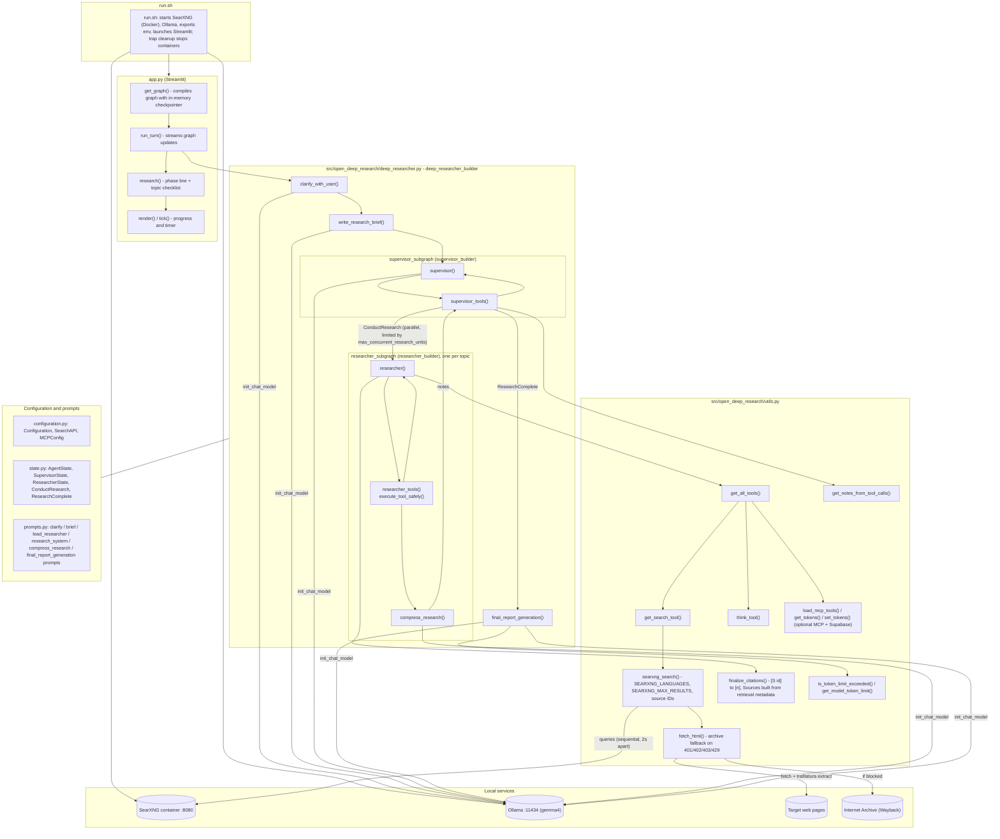

# Architecture

All paths are relative to the repo root.

## Flow

1. [run.sh](../run.sh) starts SearXNG and Ollama, sets env vars, and runs [app.py](../app.py).
2. [`run_turn`](../app.py) streams the graph; [`research`](../app.py) maps node names to the phases Clarify, Brief, Research, Report.
3. [`clarify_with_user`](../src/open_deep_research/deep_researcher.py) may ask a question, otherwise [`write_research_brief`](../src/open_deep_research/deep_researcher.py) creates the brief.
4. [`supervisor`](../src/open_deep_research/deep_researcher.py) plans topics; [`supervisor_tools`](../src/open_deep_research/deep_researcher.py) runs a researcher subgraph per `ConductResearch` call.
5. [`researcher`](../src/open_deep_research/deep_researcher.py) calls [`searxng_search`](../src/open_deep_research/utils.py) and `think_tool`; [`compress_research`](../src/open_deep_research/deep_researcher.py) returns a note that cites sources by ID (`[S3f9a1c]`).
6. [`final_report_generation`](../src/open_deep_research/deep_researcher.py) writes the report with source IDs, then [`finalize_citations`](../src/open_deep_research/utils.py) numbers them by first appearance and builds the Sources list from the retrieved metadata (unknown IDs are dropped).

## Tests

- [tests/test_live_search.py](../tests/test_live_search.py): SearXNG and Trafilatura connectivity.
- [tests/test_live_research.py](../tests/test_live_research.py): end-to-end research quality over several questions in `CASES` (facts retrieved and reported, grounded citations, claims supported by cited sources). Run with `uv run pytest -m live`.
